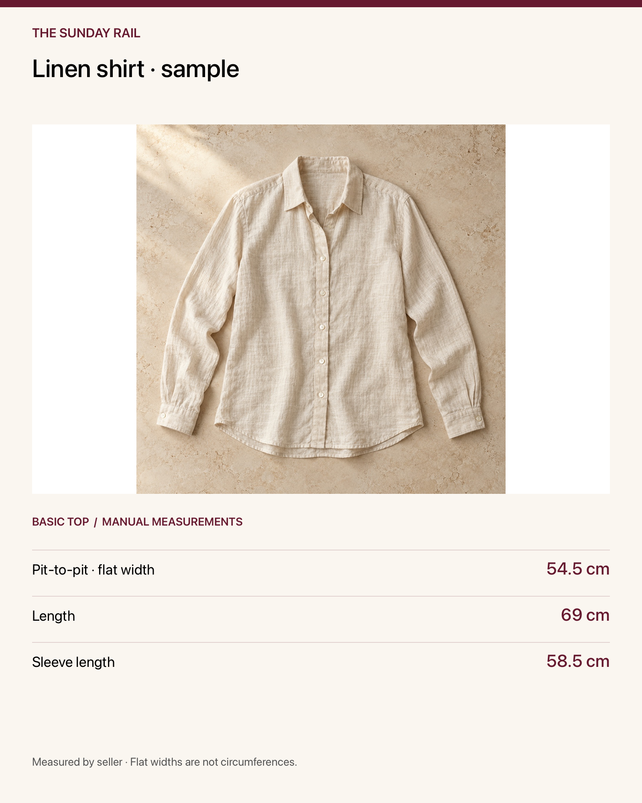
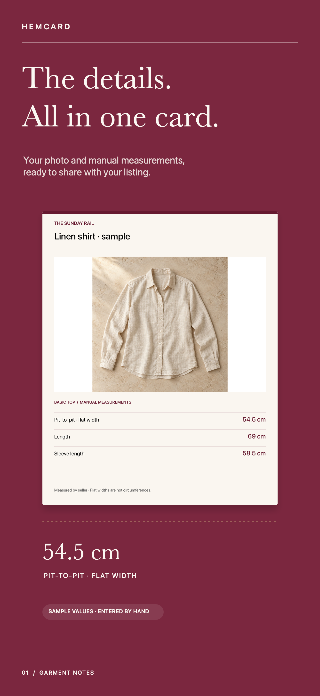
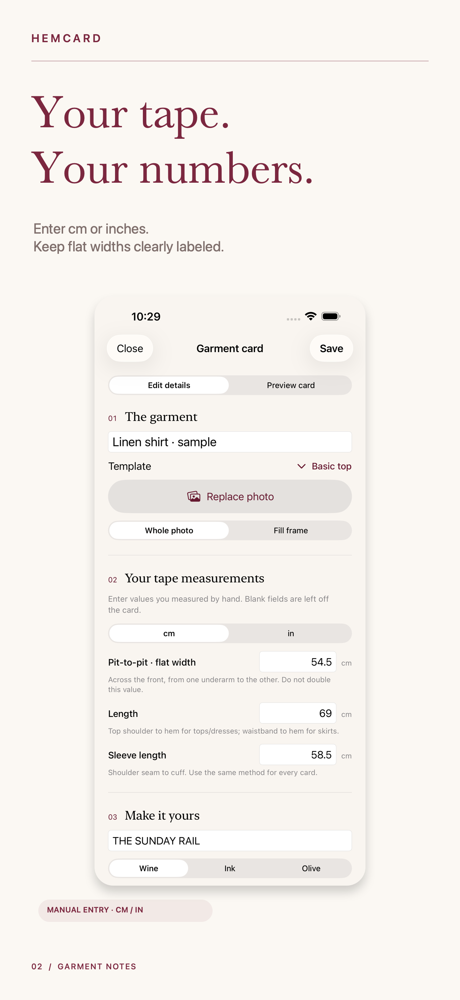
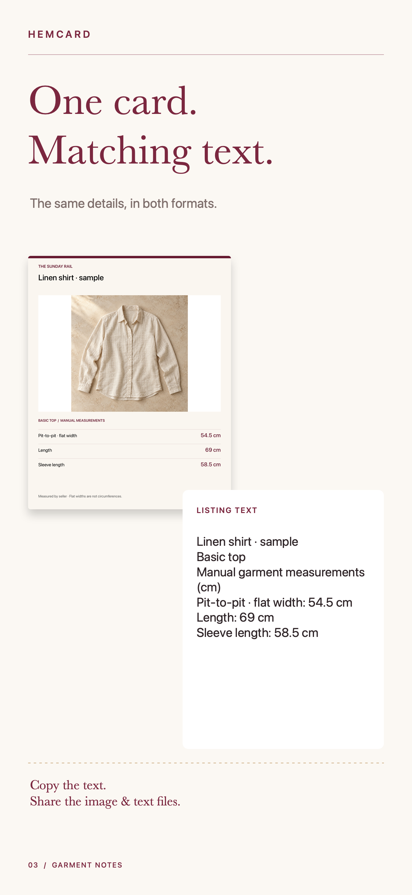
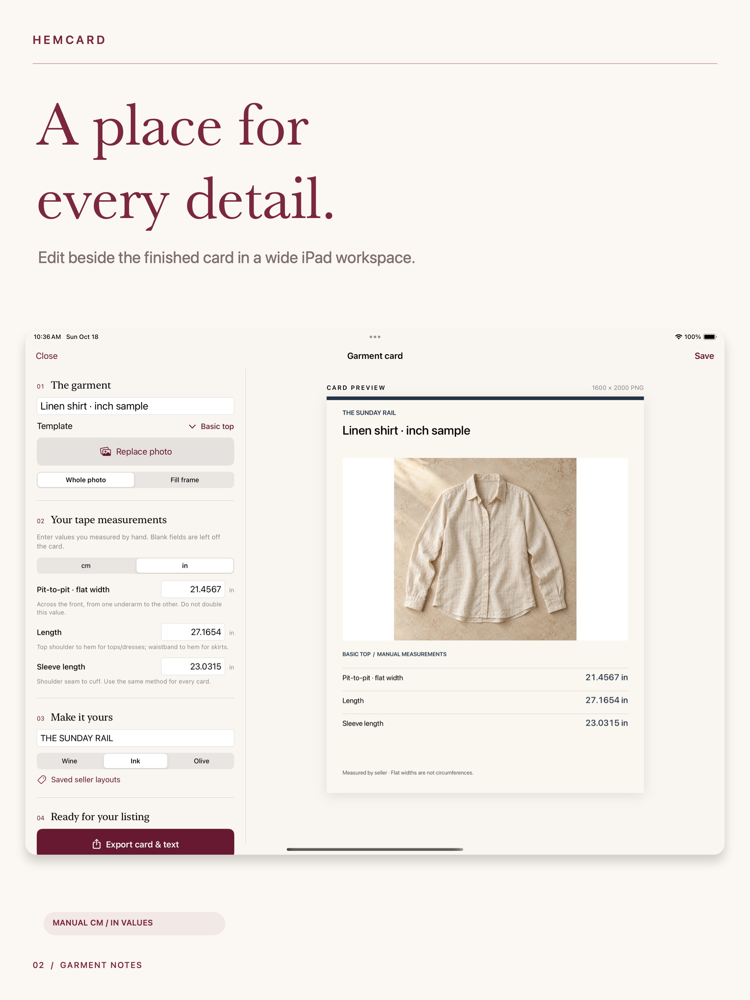
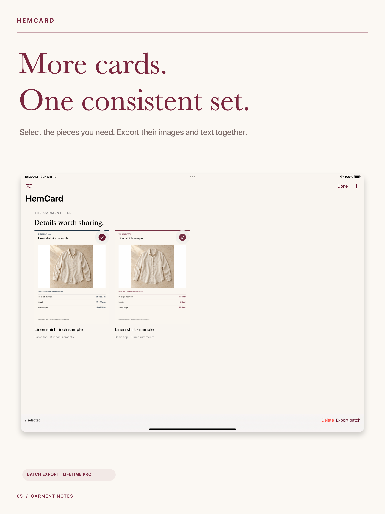

# HemCard · Clothing Measurements

**Your photo. Your tape measurements. One clear garment card.**

HemCard turns seller-entered clothing measurements into a consistent photo card and matching listing text. Built for clothing resellers who already measure by hand and want those details to travel together.

**Current review — October 19, 2026:** app **1.0(1) Rejected under 4.3(a)**; Lifetime Pro **Ready for Review**. An app-specific clarification was posted and verified at **October19,2026 17:59PDT**, requesting the specific comparator/overlap and any concrete safety, security or quality issue. No corrective binary, resubmission, approval or release is claimed.

[Product & support](https://sepidehdalir.github.io/hemcard/) · [Privacy](https://sepidehdalir.github.io/hemcard/privacy.html) · [iOS portfolio](https://github.com/sepidehdalir/ios-app-portfolio)

The sample photograph is original generated imagery. Values are illustrative entries, not measurements inferred from the image.

## The campaign

  

 

[Full iPhone campaign](assets/phone-campaign.png) · [Dedicated iPad campaign](assets/ipad-campaign.png)

## The product

Select a garment photo, enter your own tape measurements, choose centimeters or inches, inspect the card, then export its image/text files or copy the listing text. Flat widths are explicitly labeled. Blank fields stay off the card.

Basic top cards, saved local records and single export are free. One optional Lifetime Pro purchase adds batch export, named seller presentation layouts and trousers, skirt, dress and outerwear templates. No subscription.

HemCard does not measure from a camera, predict fit, guarantee accuracy, connect to marketplaces or publish listings.

## Engineering

- Universal SwiftUI app targeting iOS/iPadOS15, built with Xcode26.5 and native Apple frameworks.
- Exact integer measurement storage with strict locale-aware decimal entry. Display-unit changes preserve the canonical value; image and text use the same field/formatting pipeline.
- Atomic schema-versioned local persistence; failed writes retain the previous saved state. Corrupt or future-schema files are preserved rather than overwritten.
- PHPicker selection with transformed/downsampled, re-encoded photo copies. Preview and PNG export share the same crop geometry; original GPS/EXIF is not copied into generated output.
- An iPad editor/preview workspace, with wider single-pane editing at accessibility text sizes.
- StoreKit2 verified entitlements, transaction updates, restore, pending/cancel/error handling and data retention after revocation.
- Collision-safe PNG/TXT batch output, per-card failure handling and native system sharing.

Core numerical/persistence/rendering tests and local StoreKit outcomes passed on the iOS17 simulator. Final small-phone and tablet UI workflows, native simulator photo selection/manual entry/persistence, and physical-device Files export/relaunch checks also passed. iOS15 runtime is unavailable on the current host; deployment-target compilation does not claim an iOS15 runtime pass. TestFlight is skipped by publisher instruction. Data Not Collected was published in App Store Connect with explicit owner approval. A remote product loaded on the physical device. Remaining genuine Sandbox purchase, verified remote entitlement, restore and relaunch checks were explicitly skipped by the publisher, not passed; earlier failed attempts are retained privately. Actual App Review submission is verified.

## Privacy

No account, backend, tracking SDK, advertising or external AI service. Cards and selected photo copies stay in the app's local storage; the user chooses export destinations. Session-only event counters contain no user content and are not transmitted.

## Design and delivery

Tailoring-inspired burgundy, warm ivory, serif typography, fine rules and a recognizable garment-tag icon. Dedicated five-frame phone and five-frame tablet campaigns were inspected as full-size exports and thumbnail grids. They use authentic app UI and actual exported cards. Commercial source is backed up separately in a private repository.

Created by **Sepideh Javanbakht Dalir** · [arvinify.com](https://www.arvinify.com) · [hello@arvinify.com](mailto:hello@arvinify.com)
